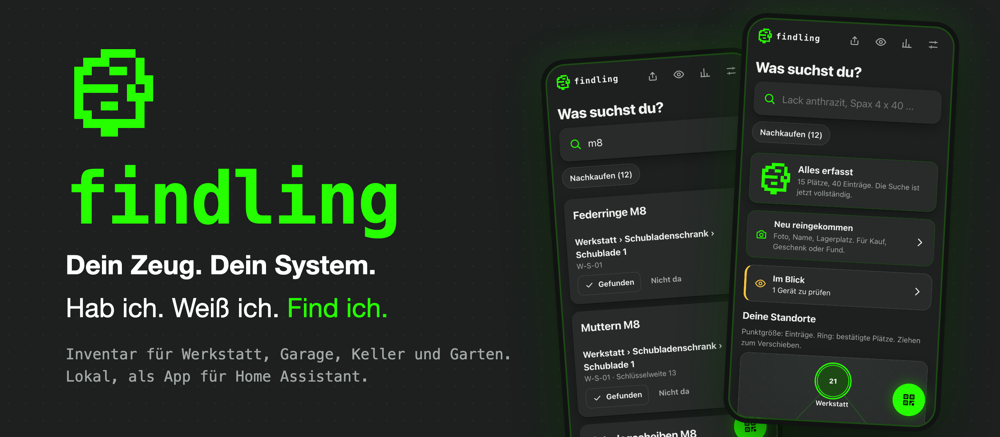
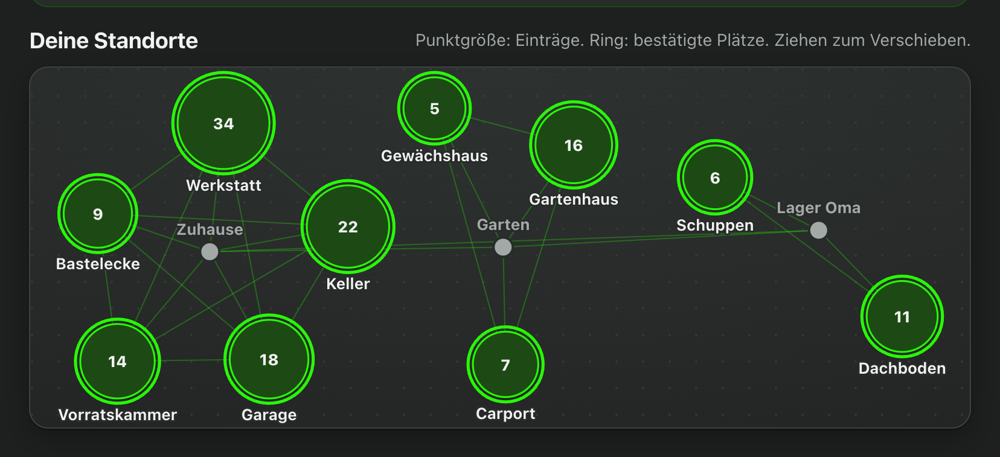
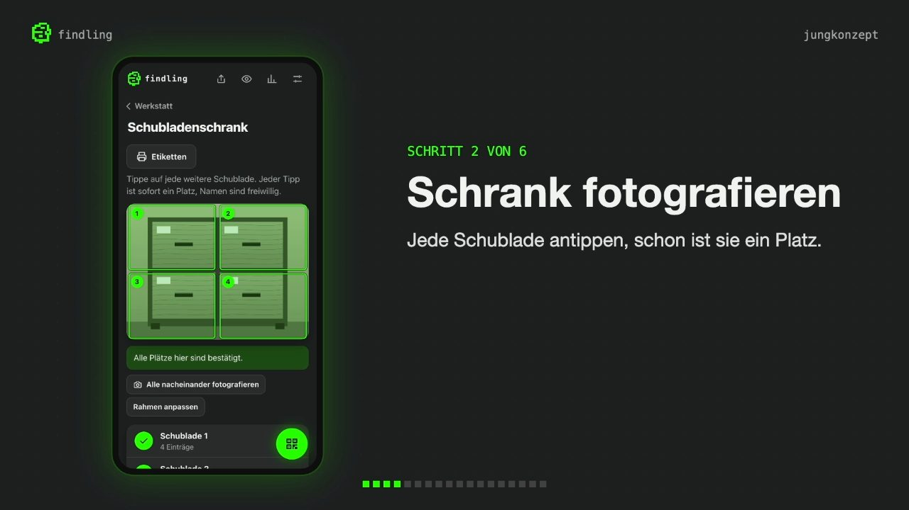
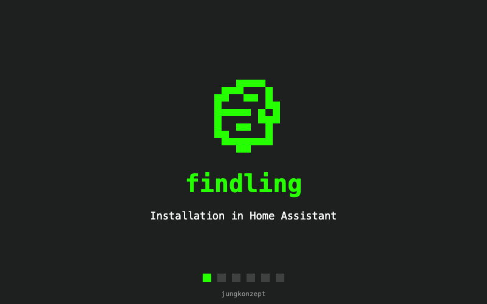

# findling

[Deutsch](README.md) · **English**



**Your stuff. Your system.** Got it. Know it. Find it.

findling is an inventory for workshop, garage, basement, pantry and garden shed. It runs as an app in Home Assistant, entirely on your own home network. A photo of the cabinet, a tap on every drawer, a photo of the contents: after that the search answers the question “Do I still have it, and where is it?”.

The app's interface is available in German and English. The screenshots and the video show the German version.

## A network of places (example)



Things rarely live in one place. findling connects all storage places into one network: the home with workshop, basement and garage, the garden with shed and carport, plus the storage at your parents' house or the holiday flat. Every room is a node, its size shows how much is there, and a tap takes you inside. The search covers all locations at once.

## Explained in two minutes

[](https://videos.files.wordpress.com/Tqn4iL8w/findling.mp4)

A click on the image opens the explainer video (about two minutes, in German).

## What findling does

- **Find:** Search across names, notes, parts lists, maker, model and serial number. Every spot has an address and a QR label.
- **Record:** Room, cabinet, spot, contents. Guided with the camera, with the quick entry “Just came in”, or as a bulk import from a spreadsheet.
- **Maintain:** Stock level or device condition, quantity, profile with documents, maintenance, lending and history.
- **Share and print:** Shopping list as PDF, labels, inventory and profiles for printing.
- **Keep:** Automatic backups with photos and documents, optionally to a network drive. Deleted things stay in the trash for 30 days.

The full list is in [FEATURES.md](FEATURES.md) (German).

## Local and hardened

- Access only through the Home Assistant sign-in (ingress), only for administrators. No open port, no separate password.
- No permissions for Home Assistant, the Supervisor, the server's network or other folders.
- The program runs in the container as its own user without root rights, with an enforced AppArmor profile, and cannot change its own code.
- Strict Content Security Policy: scripts and images only from your own server.
- Data leaves the home network in two named cases only: with an image recognition you explicitly trigger using your own API key, and when you deliberately share a file. Without a key there is no outbound connection.
- The API key and the PIN are only in the app's configuration and never part of a backup.

## Documentation

The full manual is on jungkonzept.de: [findling documentation](https://jungkonzept.de/findling-documentation/). It leads from setup through recording, searching and labels to backups and frequently asked questions.

## Installation



You need Home Assistant OS (or Supervised) on `aarch64` or `amd64`.

1. In Home Assistant open **Settings › Apps › Install app**, choose **Repositories** in the menu at the top right and add the address of this repository.
2. Open **findling** and choose **Install**. The server builds the app itself, which takes a few minutes.
3. On the **Configuration** tab enter the address your phone uses to reach Home Assistant on your home network. It goes into the QR codes. Set the language to `en` for the English interface.
4. Turn on **Show in sidebar** and choose **Start**. The log then shows `findling läuft.`

It also works without the repository: copy the `findling` folder to `local_apps` (formerly `addons`) via the Samba share, choose **Check for updates** and install it under **Local apps**.

Everything else is in the [documentation](https://jungkonzept.de/findling-documentation/).

## Structure

| Path | Contents |
|---|---|
| `findling/` | The app for Home Assistant: configuration, Dockerfile, AppArmor profile, program under `app/` |
| `tests/` | Tests for server, backups, copy service and security profile |
| `repository.yaml` | Marks the repository for Home Assistant |

The server only needs the Python standard library and SQLite, the interface works without a framework. Run the tests with:

```bash
python3 tests/test_server.py
```

## License and liability

findling is released under the [MIT license](LICENSE). The software is provided as is: without warranty, without any promise of fitness for a particular purpose and without any claim to support, updates or bug fixes. Use it at your own risk. Before using it with your own data, a backup of Home Assistant is recommended.

The statements under “Local and hardened” describe how the app is built. They are no assurance that the software is free of errors or security vulnerabilities.

### Third-party software included and used

| Software | Purpose | License |
|---|---|---|
| [jsQR](https://github.com/cozmo/jsQR) | Reading QR codes, located in `findling/app/static/vendor` | Apache-2.0, license text included |
| QR Code Generator for JavaScript (Kazuhiko Arase) | Creating QR codes, located in `findling/app/static/vendor` | MIT, notice in the file header |
| [anthropic](https://pypi.org/project/anthropic/) and its dependencies | Image recognition on explicit tap, installed when the app is built (`findling/requirements.lock`) | License of the respective packages |

“QR Code” is a registered trademark of DENSO WAVE INCORPORATED. Home Assistant is a project of the Open Home Foundation; findling is independent of it.

a development by [jungkonzept.de](https://jungkonzept.de/)
