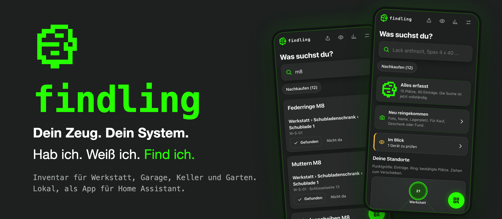
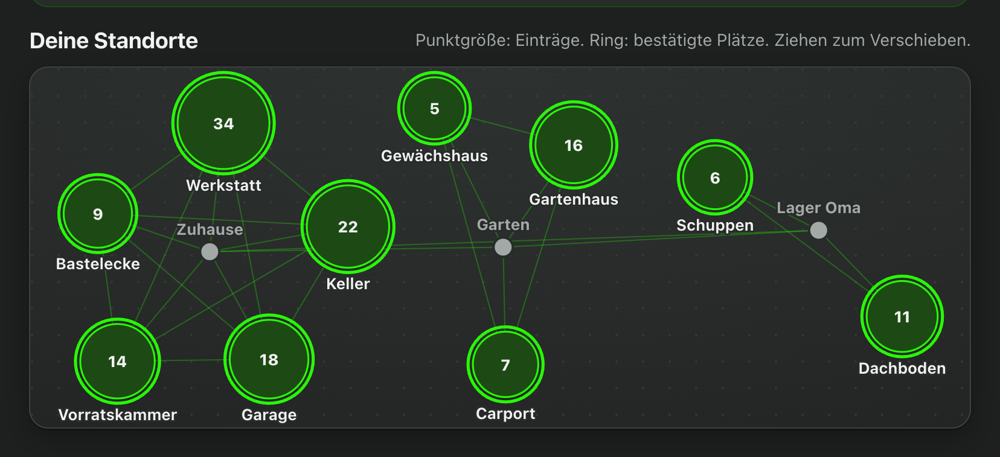
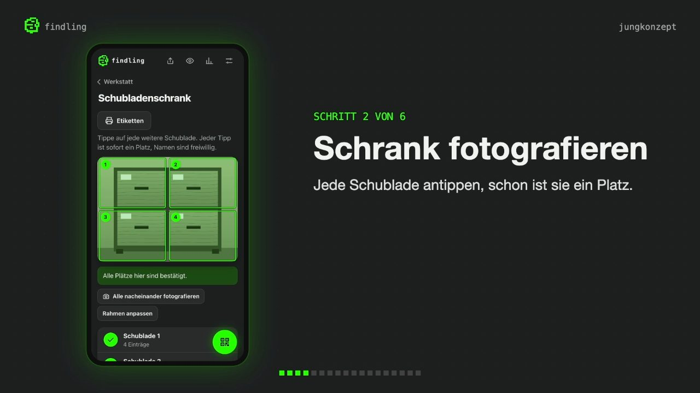
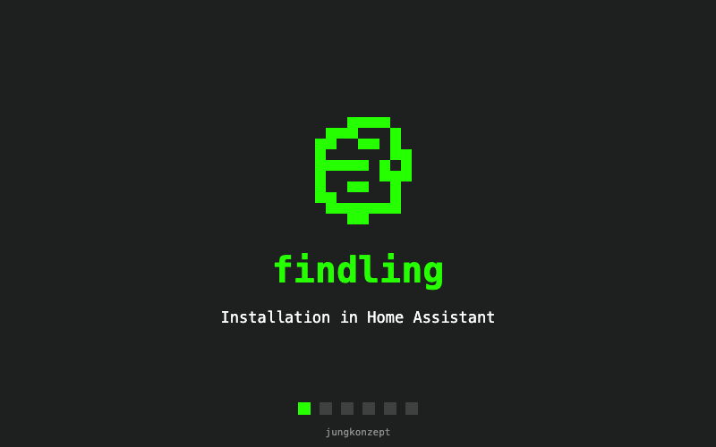

# findling



**Dein Zeug. Dein System.** Hab ich. Weiß ich. Find ich.

findling ist ein Inventar für Werkstatt, Garage, Keller, Vorrat und Gartenhaus. Es läuft als App in Home Assistant, vollständig im eigenen Heimnetz. Ein Foto vom Schrank, ein Tipp auf jede Schublade, ein Foto vom Inhalt: Danach beantwortet die Suche die Frage „Habe ich es noch, und wo liegt es?“.

## Ein Netz aus Orten (Beispiel)



Die Dinge liegen selten an einem Ort. findling verbindet alle Lagerorte zu einem Netz: das Zuhause mit Werkstatt, Keller und Garage, den Garten mit Gartenhaus und Carport, dazu das Lager bei den Eltern oder die Ferienwohnung. Jeder Raum ist ein Knotenpunkt, seine Größe zeigt, wie viel dort liegt, und ein Tipp darauf führt hinein. Die Suche geht über alle Standorte zugleich.

## In zwei Minuten erklärt

[](https://videos.files.wordpress.com/Tqn4iL8w/findling.mp4)

Ein Klick auf das Bild öffnet das Erklärvideo (rund zwei Minuten).

## Was findling kann

- **Finden:** Suche über Namen, Notizen, Teilelisten, Hersteller, Modell und Seriennummer. Jeder Platz hat eine Adresse und ein QR-Etikett.
- **Erfassen:** Raum, Schrank, Platz, Inhalt. Geführt mit der Kamera, per Schnellerfassung „Neu reingekommen“ oder als Massenimport aus einer Tabelle.
- **Pflegen:** Füllstand oder Gerätezustand, Anzahl, Steckbrief mit Dokumenten, Wartung, Verleih und Verlauf.
- **Teilen und Drucken:** Mitbringliste als PDF, Etiketten, Inventar und Steckbriefe zum Ausdrucken.
- **Behalten:** Automatische Sicherungen mit Fotos und Dokumenten, auf Wunsch auf ein Netzlaufwerk. Gelöschtes bleibt 30 Tage im Papierkorb.

Die vollständige Liste steht in [FEATURES.md](FEATURES.md).

## Lokal und gehärtet

- Zugang nur über die Anmeldung von Home Assistant (Ingress), nur für Administratoren. Kein offener Port, kein eigenes Passwort.
- Keine Rechte auf Home Assistant, den Supervisor, das Netzwerk des Servers oder fremde Ordner.
- Das Programm läuft im Container als eigener Benutzer ohne Root-Rechte, mit erzwungenem AppArmor-Profil, und kann seinen Code nicht ändern.
- Strenge Content Security Policy: Skripte und Bilder nur vom eigenen Server.
- Daten verlassen das Heimnetz nur in zwei benannten Fällen: bei einer ausdrücklich ausgelösten Bilderkennung mit eigenem API-Schlüssel und beim bewussten Teilen einer Datei. Ohne Schlüssel gibt es keine Verbindung nach außen.
- Der API-Schlüssel und die PIN stehen nur in der Konfiguration der App und sind nie Teil einer Sicherung.

## Dokumentation

Das vollständige Handbuch steht auf jungkonzept.de: [findling Dokumentation](https://jungkonzept.de/findling-dokumentation/). Es führt von der Einrichtung über Erfassen, Suchen und Etiketten bis zu Sicherungen und häufigen Fragen.

## Installation



Voraussetzung ist Home Assistant OS (oder Supervised) auf `aarch64` oder `amd64`.

1. In Home Assistant **Einstellungen › Apps › App installieren** öffnen, im Menü oben rechts **Repositories** wählen und die Adresse dieses Repositorys hinzufügen.
2. **findling** öffnen und **Installieren** wählen. Der Server baut die App selbst, das dauert einige Minuten.
3. Im Reiter **Konfiguration** die Adresse eintragen, unter der das Telefon Home Assistant im Heimnetz erreicht. Sie landet in den QR-Codes.
4. **In der Seitenleiste anzeigen** einschalten und **Starten**. Im Protokoll steht dann `findling läuft.`

Ohne Repository geht es auch: den Ordner `findling` über die Samba-Freigabe nach `local_apps` (früher `addons`) kopieren, **Auf Updates prüfen** wählen und unter **Lokale Apps** installieren.

Einstellungen, Sicherungen und der Scanner sind in [findling/DOCS.md](findling/DOCS.md) beschrieben. Alles Weitere steht in der [Dokumentation](https://jungkonzept.de/findling-dokumentation/).

## Aufbau

| Pfad | Inhalt |
|---|---|
| `findling/` | Die App für Home Assistant: Konfiguration, Dockerfile, AppArmor-Profil, Programm unter `app/` |
| `tests/` | Tests für Server, Sicherungen, Kopierdienst und Sicherheitsprofil |
| `repository.yaml` | Kennzeichnet das Repository für Home Assistant |

Der Server braucht nur die Python-Standardbibliothek und SQLite, die Oberfläche kommt ohne Framework aus. Tests starten mit:

```bash
python3 tests/test_server.py
```

## Lizenz und Haftung

findling steht unter der [MIT-Lizenz](LICENSE). Die Software wird so bereitgestellt, wie sie hier steht („as is“): ohne Gewährleistung, ohne Zusage einer bestimmten Eignung und ohne Anspruch auf Support, Updates oder Fehlerbehebung. Die Nutzung geschieht auf eigene Verantwortung. Vor dem Einsatz mit eigenen Daten empfiehlt sich eine Sicherung von Home Assistant.

Die Angaben unter „Lokal und gehärtet“ beschreiben den Aufbau der App. Sie sind keine Zusicherung, dass die Software frei von Fehlern oder Sicherheitslücken ist.

### Enthaltene und genutzte Software Dritter

| Software | Zweck | Lizenz |
|---|---|---|
| [jsQR](https://github.com/cozmo/jsQR) | QR-Codes lesen, liegt unter `findling/app/static/vendor` | Apache-2.0, Lizenztext liegt bei |
| QR Code Generator for JavaScript (Kazuhiko Arase) | QR-Codes erzeugen, liegt unter `findling/app/static/vendor` | MIT, Hinweis im Dateikopf |
| [anthropic](https://pypi.org/project/anthropic/) und seine Abhängigkeiten | Bilderkennung auf ausdrücklichen Tipp, wird beim Bau der App installiert (`findling/requirements.lock`) | jeweilige Lizenz der Pakete |

„QR Code“ ist eine eingetragene Marke von DENSO WAVE INCORPORATED. Home Assistant ist ein Projekt der Open Home Foundation; findling ist davon unabhängig.

eine entwicklung von [jungkonzept.de](https://jungkonzept.de/)
